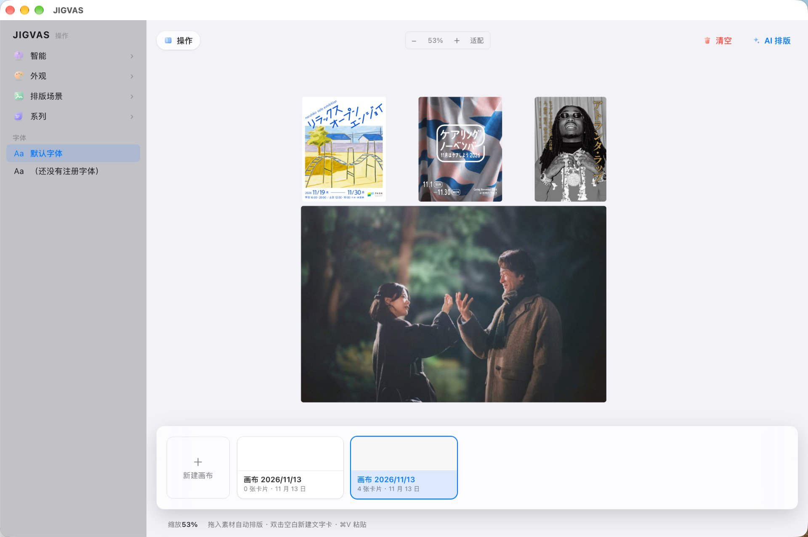

# JIGVAS

**Drop in inspiration, style emerges.**

JIGVAS is a local-first layout canvas for macOS. Drop images, notes and links onto one canvas and AI turns them into a designed page — with five layout styles to switch between and one-click export for wherever you publish. No sign-up, no cloud, no project setup.



## Highlights

- **From scattered to finished in seconds.** JIGVAS reads your materials, matches a style and applies real typographic constraints — grid, hierarchy, spacing and contrast in one pass. Every card stays editable, and your manual placement always wins.
- **Private by default.** Canvases and materials stay on your Mac. The layout engine works offline, with no analytics and no telemetry. No account is required.
- **Five styles, one click.** Swiss International, JP Editorial, Neo Brutalism, Bento and Nordic. Switch the whole page instantly; your manual tweaks survive the switch.
- **Finished once, exported per channel.** Social posts, landscape articles, magazine posters and A4 print — ratios and type scales adapt automatically. Export PNG, JPG or PDF.
- **Free to use.** All five styles, unlimited editing and export are free. Pro has not launched and nothing is charged before it does.

## Getting started

1. **Drop your materials in.** Drag images, text and links from Finder or your browser straight onto the canvas — ⌘V works too. Each item lands as a card.
2. **Let AI lay it out.** A skeleton appears immediately, then refines in the background while you keep working.
3. **Tweak, then export.** Nudge a card, switch styles, choose your target size and export. No layers, no dialogs, no setup.

## Download

- **[Download for Mac](downloads/JIGVAS-0.3.3-20261115.dmg)** — recommended, about 2.6 MB
- **[ZIP archive](https://www.jigvas.com/download)** — unzip and run
- **[SHA256SUMS.txt](downloads/SHA256SUMS.txt)** — checksums
- Website: **[www.jigvas.com](https://www.jigvas.com/)**

Current version: **0.3.3** (15 November 2026). Use the latest build; older releases are deprecated.

### System requirements

- An Apple silicon Mac (M1 or later): Mac mini, MacBook Air, MacBook Pro, iMac, Mac Studio or Mac Pro
- macOS 11 Big Sur or later

### Install

1. Open the DMG and drag **JIGVAS** into Applications.
2. On first launch, macOS asks whether you want to open an app downloaded from the internet — click **Open**. That is the only prompt.
3. Launch it normally afterwards from Launchpad or Spotlight.

This build is signed with an Apple Developer ID certificate and notarized by Apple, so you do not need to change any security settings, right-click to open, or run terminal commands. If you downloaded the ZIP, unzip it and double-click JIGVAS; the same one-time **Open** confirmation applies.

### Verify your download

```bash
cd downloads
shasum -a 256 -c SHA256SUMS.txt
```

DMG SHA-256: `0d570c5fedea7f0fc140e11422c7bb8b3b2d0c83d59cdd2430ce04937d74686d`

## AI and your data

AI layout works out of the box with a trial quota. For long-term use, add your own OpenAI-compatible API key (kept in the macOS Keychain) or connect a local model through Ollama to run fully offline. When you use AI, only semantic descriptions of your materials are sent to the provider **you** configured — never to us. We operate no relay server and keep none of your content.

## Feedback & Support

- **Bugs, feature requests, questions** — post them in **[Issues](https://github.com/Preteridea/jigvas/issues)**.
- **Anything private** — email **contact@jigvas.com**. Please never post personal details in a public issue.
- **Reporting a bug?** Include your macOS version, the JIGVAS version (JIGVAS → About JIGVAS) and what you did just before it happened. A screenshot saves a round trip.

> **Note** — This repository hosts the public download and the issue tracker. JIGVAS is distributed as a ready-to-run Mac app.

## Company

JIGVAS is made by **Suzhou Preteridea Creative Design Co., Ltd.** · [www.jigvas.com](https://www.jigvas.com/)
